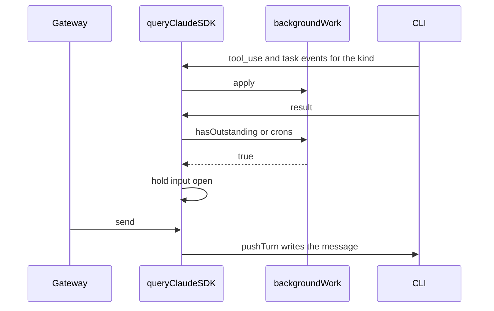
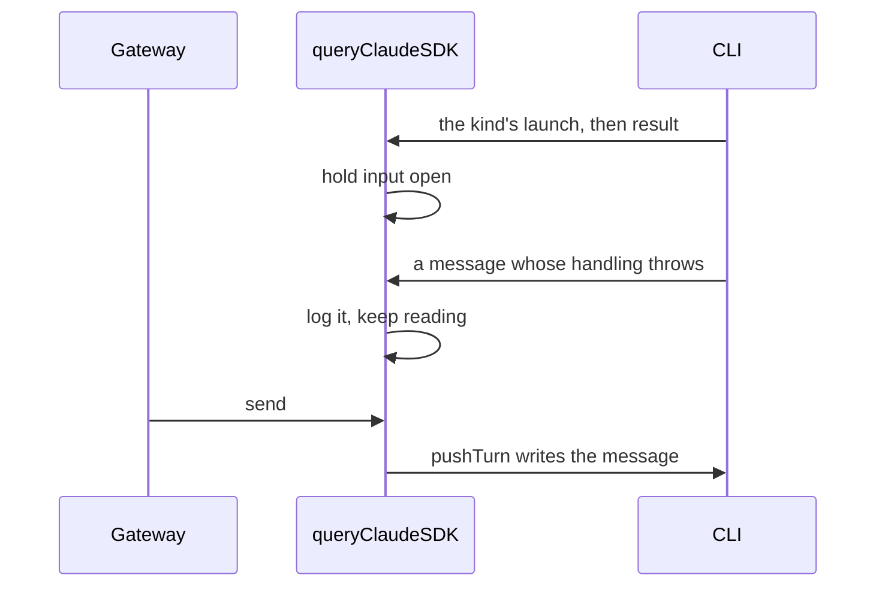
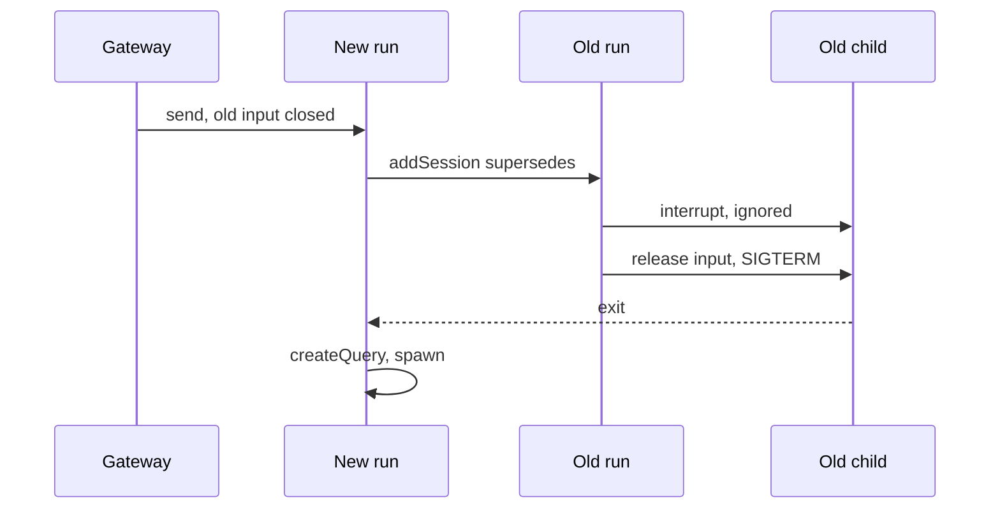
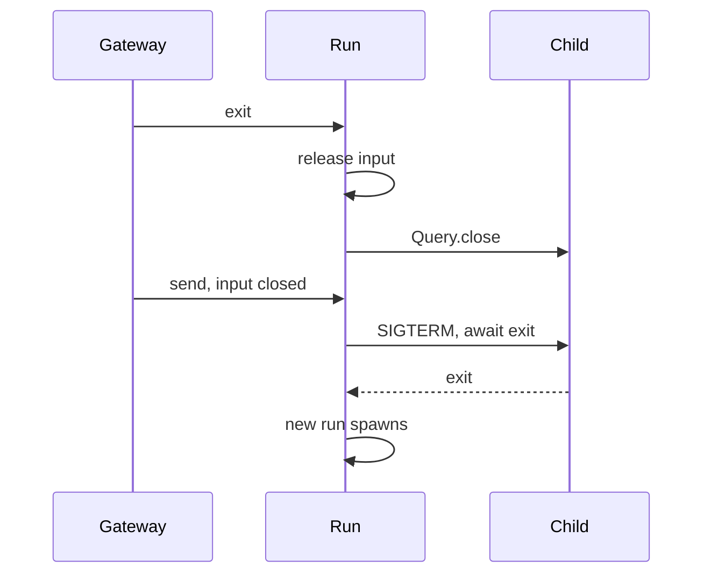
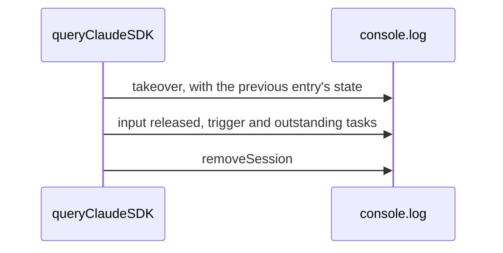

# The Claude CLI process lifecycle

*How the Claude runtime keeps one CLI process per session, when a send is pushed into it
and when it takes the session over. Everything here lives in
`server/modules/providers/list/claude/claude-runtime.provider.js` unless a path says
otherwise; the tests are in `server/modules/providers/tests/claude-runtime-hold.test.ts`.
The requirement is [#69](https://github.com/jgong5/claudecodeui/issues/69); the evidence
is [#67](https://github.com/jgong5/claudecodeui/issues/67).*

## In one paragraph

A run (`queryClaudeSDK`) owns one CLI process and one `activeSessions` entry, keyed by the
app session id. The entry carries the run's `controls`. Its prompt stream (`createInputStream`)
stays open after a turn's `result` while background work is outstanding, so the CLI keeps
running. A later send asks `controls.isInputOpen()`. When open, `pushTurn` writes the message
into the live process. When closed, the send takes the session over (`takeOver`). That
starts a new process, after the old one has exited.

## Why a send fails to push

A send is pushed only while the entry exists and its input is open. #67 names the two ways
that can fail.

**(a) Input released while work is outstanding.** Input is released (`releasePromptStream`)
on these triggers:

| Trigger | Where |
| --- | --- |
| turn end with nothing to hold | the `result` branch, when `holdForTurn` is false |
| last tracked task stopped | the `task_notification` / `stopped` branch |
| silence ceiling | `scheduleRelease` timer (`BG_WAIT_CEILING_MS`, off at `0`) |
| supersede | `addSession`, superseding branch |
| `/exit` | `exitClaudeSDKSession` |
| stop during setup | `cancelSetup` |
| run end | the `finally` of `queryClaudeSDK` |

The first two read `createBackgroundWorkTracker`. The table below shows what each kind in
#69 sends and what `backgroundWork.apply` does with it, measured on CLI 2.1.330 (see
Dependencies).

| Kind | Stream | `apply` |
| --- | --- | --- |
| background Bash | `task_started` `local_bash`, `tool_use_id` = the Bash call | tracked, `toolName: Bash` |
| agent | `task_started` `local_agent`, `tool_use_id` = the Agent call | tracked, `toolName: Agent` |
| agent resumed via `SendMessage` | `task_started` `local_agent`, the first run's `task_id`, `tool_use_id` = the `SendMessage` call | tracked, `toolName: SendMessage` |
| same, its subagent's foreground Bash | `task_started` `local_bash`, `tool_use_id` = a call inside the agent | tracked, `nested` |
| same, while running | `task_progress` | ignored |
| same, at its end | `task_updated` with patch `completed`, then `task_notification` | removed by the first |
| workflow | `task_started` `local_workflow` | tracked |
| Monitor | `task_started` `local_bash`, `tool_use_id` = the Monitor call | tracked, `toolName: Monitor` |
| `CronCreate` | no task events; the `Stop` hook's `session_crons` | `setCrons`, held by `holdForSchedule` |

What `apply` drops is a `task_started` with no `tool_use_id` (the CLI's own housekeeping) and
a non-terminal `task_updated`. Neither is work a user started. So at the `result` of a turn
that leaves any of these kinds running, `stillOutstanding` or `holdForSchedule` is true and
the turn holds, and the stopped-task release waits for the last one. **Path (a) has no defect
for any kind on 2.1.330**: its tests pin today's behaviour (Ruling on #70).

**(b) `removeSession` dropping a live entry.** `removeSession` is called at the run loop's end,
in the run's `catch`, on a stop during setup, and by `exitClaudeSDKSession`. These can drop an
entry while its process lives:

1. **A throw while handling one message.** Any throw in the loop body (`normalizeMessage`, a
   writer, the hold bookkeeping) leaves the `for await`. The `catch` then removes the entry
   and the `finally` releases input. Leaving the loop runs the SDK's cleanup
   (`sdk.mjs: Query.readSdkMessages`, then `performCleanup`), which calls
   `ProcessTransport.close`: the process and its background work die within about 7 s, and a
   send in that window builds a second process. This is the only caller that drops an entry
   still taking input with work outstanding. The SDK side ends the loop only at exit
   (`sdk.mjs: ProcessTransport.readMessages` awaits `waitForExit`, then throws `exitError`).
2. **`/exit`.** `exitClaudeSDKSession` removes the entry right after `Query.close()`, which
   SIGTERMs only after a 2 s grace and SIGKILLs 5 s later (`sdk.mjs: ProcessTransport.close`).
3. **Ownership matched on `instance`.** The `catch` removes when
   `getSession(key)?.instance === queryInstance`, and `null === null` holds. A run that fails
   in setup after a stop removes the entry of the run that took the session over.

Seen from the gateway, path (b) beside a live process refuses the send rather than starting a
second process. `dispatchRun` (`chat-websocket.service.ts`) asks `isSessionHeldExternally`
first. `listExternalClaudeCliSessions` (`claude-cli-liveness.service.ts`) counts every live CLI
in `~/.claude/sessions` whose session has no runtime entry. The CLI writes that file for
SDK-spawned processes too: the one for #67's pid 1057024 reads `entrypoint: sdk-ts`. So #67's
second processes came through an entry whose input was closed. The release log line names
its trigger the next time it happens.

## Scenarios

### A send while work is outstanding is pushed, path (a), each kind (A2)

The test, one per kind: emit the kind's stream from the table above, then `result`, then
`send`. It asserts one query and that the last input is the message with `priority: 'next'`.
It passes on `main` today.

### A throw while work is outstanding does not end the run, path (b), each kind (A2)

The test, one per kind: the launch as in path (a), then the test makes
`context.normalizeMessage` throw for one message, then `send`. It asserts one query and the
pushed message. On `main` it fails: the throw ends the run, the entry goes, and the send
builds a second query.

### A takeover never leaves two processes (A3)

The test's scripted query calls the `spawnClaudeCodeProcess` the runtime set, with
`process.execPath` and a script that keeps running after stdin ends; the scripted
`interrupt()` does nothing. The query ends its stream when that child exits, as the SDK's
does. The turn ends with nothing outstanding, so
input closes while the child lives. A `send` then takes over. The test asserts that the
child got SIGTERM (`signalCode`) and that the second `createQuery` came after its `exit`.
With decisions 1 and 2 reverted it fails: no child is spawned or signalled, and the second
query is built at once.

### `/exit`, then a send

Covered by the A3 mechanism. The entry stays until the run ends, so the send finds it and
supersedes.

### The log lines (A4)

The test mocks `console.log`. It sets `BG_WAIT_CEILING_MS` to 20 ms, holds the session for a
tracked Monitor, and lets the ceiling fire. It then ends the stream. It asserts one takeover
line, one release line naming `silence ceiling` and the Monitor's task id, and one
`removeSession` line.

## Decisions

1. **The runtime spawns the CLI itself.** `sdkOptions.spawnClaudeCodeProcess` makes the
   same `spawn` call the SDK makes (`stdio` pipe, pipe, ignore; its `cwd`, `env` and
   `signal`), and keeps the child on `controls` with a promise settled by its `exit`, or by
   its `error` when the spawn fails. Basis: code,
   `sdk.mjs: ProcessTransport.spawnLocalProcess` is one `spawn`, and `sdk.d.ts:
   Options.spawnClaudeCodeProcess` takes any `SpawnedProcess`, which a `ChildProcess` is.
   Rejected: supersede through `Query.close()`. It sends SIGTERM only inside the SDK, 2 s
   later, where the hold tests' scripted query cannot see it.
2. **Supersede sends SIGTERM at once and the new run waits for the exit.** The superseding
   branch of `addSession` calls `interrupt()` without awaiting it, releases input, and
   SIGTERMs the child if it has not exited. It returns the child's exit promise, which
   `takeOver` keeps and the run awaits just before `createQuery`. Basis: code,
   `Query.interrupt()` is a control request that a stuck CLI may never answer, and it never
   ends a held process. Rejected: SIGTERM once the interrupt settles, which may never happen.
3. **No SIGKILL.** Basis: principle, no generality for speculative needs (default
   principles). The CLI exits 143 on SIGTERM (#67). Rejected: escalating after a timeout,
   which guards a CLI that ignores SIGTERM, which nothing has shown.
4. **A throw while handling one message is logged and the loop goes on.** The loop body sits
   in a `try` inside the `for await`. The catch writes a `console.error` line and reads the
   next message. With that, the run ends only when the SDK stream does, at the process's
   exit, and one bad message no longer costs the session its background work. Basis: code,
   path (b) item 1 above. Rejected: keeping the entry until the child's exit but ending
   the run. The `finally` would still release input, so the send takes over
   instead of being pushed, and A2 fails for path (b).
5. **Removal stays at the run's end, matched on `controls`.** The loop end and the `catch`
   remove only when `getSession(key)?.controls === controls`, as the setup-cancel path
   already does. Basis:
   code, path (b) item 3. With decision 4 the run's end is the process's exit. Rejected: a
   removal on the child's `exit` event, a second site for the same moment.
6. **`/exit` releases input and closes the query, and leaves removal to the run's end.** A
   second `/exit` returns false once the instance is in `supersededInstances`. Basis: code,
   path (b) item 2. The existing test "Stop interrupts the turn and cancels queued pushes;
   /exit closes the process" expects that false. Rejected: a new `status` value.
   `getClaudeSDKSessionStartTime` and the supersede check read `status === 'active'`, so the
   dying process would look external and a takeover would skip its SIGTERM.
7. **Path (a) gets tests and no fix.** The resumed agent and Monitor are tracked (#71, #72).
   An agent launched by an earlier process and resumed in this one has an id new to the
   CLI's task registry, and the registry's register function sends `task_started` for any
   new id (CLI 2.1.330 bundle).
   The comments on `sawTaskEventThisTurn`, `keepUntrackedHold` and `DEFERRED_WORK_TOOLS` that
   call Monitor untracked are corrected. So is the tracker's note that a foreground Bash
   emits nothing (a subagent's does). Monitor stays in `DEFERRED_WORK_TOOLS` as the fallback
   for a stream with no task events. Basis: the spikes, and Ruling (a) on #70. Rejected: a
   third spike on the cross-process resume, since it goes through the same register call.
8. **Logs: `console.log`, prefix `[Claude SDK]`, one line each.**
   - Input released: logged once, when input actually closes. It carries the session key,
     the trigger from the table above, and the session's tasks from `backgroundWork.list()`.
   - `removeSession`: logged inside `removeSession`, so every caller gets it.
   - Takeover: logged in `takeOver`, with the previous entry's state (none, input closed,
     setup), which tells path (a) from path (b).

   Basis: code, the runtime already logs with `console.log` and no logger module exists under
   `server/`. Principle: follow the project's existing conventions. Rejected: a logger
   module, a new module for a few lines.
9. **One task.** Every change is in `queryClaudeSDK` and the functions beside it, so two
   tasks would conflict on each hunk. Basis: `split_loc` is 1000 and the estimate is far
   below. Rejected: logs as a task of their own.

## Simpler alternative

Logs only, as #67's own fix order has it: log, then fix what the log names. It fails A3, since
nothing stops a superseded process. It also fails A2 for path (b), since nothing would make
those tests pass. The next simplest supersedes through `Query.close()` and waits on the old
run's end, with no spawn hook (decision 1). It fails A3 as checked: the SIGTERM happens inside
the SDK 2 s later, and the scripted query the hold tests use cannot observe it.

## Low confidence

None.

## Dependencies

- [#71](https://github.com/jgong5/claudecodeui/issues/71): a `SendMessage` resume starts a
  tracked task. At turn 2's `result`, `hasOutstanding` was true in 5 of 5 runs. Spike PR
  [#74](https://github.com/jgong5/claudecodeui/pull/74) at
  `f7711d5c1d0bbf7a3fdc494b1263504068398900`, closed unmerged.
- [#72](https://github.com/jgong5/claudecodeui/issues/72): Monitor starts a tracked task.
  The tracker held a `toolName: Monitor` task at `result` in 10 of 10 runs. Spike PR
  [#73](https://github.com/jgong5/claudecodeui/pull/73) at
  `f9465ea877b3746449c000f67d4a115d6be574e7`, closed unmerged.
- No sync issue: nothing here is upstream-only.

## Summary

**Deliverable.** One process per Claude session. A send with live background work is pushed,
for every kind in #69. Each input release, `removeSession` and takeover is logged.

**Scope and non-goals.** As #69. Other providers, transcript load time, client UI, the meaning
of `BG_WAIT_CEILING_MS` and the live check stay out. Out too: stderr piping under
`DEBUG_CLAUDE_AGENT_SDK`, which the SDK's own spawn does and the hook leaves out. The
existing tests' `holdForMonitor` fixture, a Monitor with no task events, stays: it exercises
the static rule.

**Changes per file.**

- `claude-runtime.provider.js`
  - `queryClaudeSDK` gets the spawn hook, the per-message `try`, the release trigger
    argument and log, and `takeOver`'s wait and log.
  - Removal at the loop end and in the catch is matched on `controls`.
  - `addSession`: SIGTERM in its superseding branch, and it returns the exit promise.
  - `removeSession`: its log line.
  - `exitClaudeSDKSession`: release, close, no removal, false when already ending.
  - The comment corrections of decision 7.
- `claude-runtime-hold.test.ts`: a table of the kinds in #69, each run through a path (a)
  test and a path (b) test, plus the A3 and A4 tests. Existing tests unchanged.

**Acceptance.** A1 is the gate. A2: one test per kind and path. The path (b) tests fail with
decision 4 reverted. The path (a) tests pass on `main` (Ruling on #70). A3: the takeover
test, failing with decisions 1 and 2 reverted. A4: the log test.

**Task.** One task, file set the two files above. Estimate: code about 110 added, 190 moved
(the loop body's new indent) and 15 deleted; tests about 280 added.
